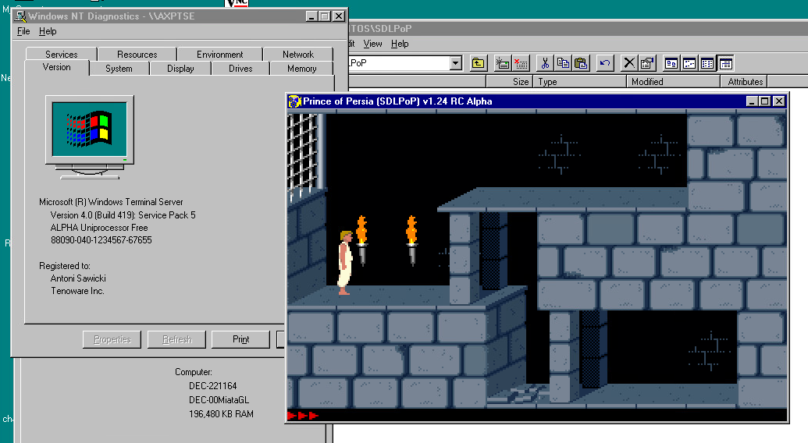

# popNT - SDLPoP port to NT RISC



https://github.com/NagyD/SDLPoP

Builds for NT4.0 with MSVC 4.0 (cl 10).

Requires https://github.com/tenox7/SDL4NT

## PINT 4.0 (Windows NT 4.0 on the Raspberry Pi)

The releases have `prince-pint40-arm.zip`: the game with its data, built with the PINT 4.0 SDK in Docker
([tenox7/pint40sdk](https://hub.docker.com/r/tenox7/pint40sdk); its page tells how to set it up once).
SDL4NT goes in a folder named `SDL` beside this one:

```
git clone https://github.com/tenox7/SDL4NT SDL
git clone https://github.com/tenox7/popNT
docker run --rm -v msvc-arm32:/opt/msvc -v "$PWD":/src -w /src/SDL tenox7/pint40sdk nmake
docker run --rm -v msvc-arm32:/opt/msvc -v "$PWD":/src -w /src/popNT/src tenox7/pint40sdk nmake
```

Not for PINT 3.5: SDL4NT needs parts of Windows NT 4.0 that NT 3.5 does not have (the IME API, for one).
